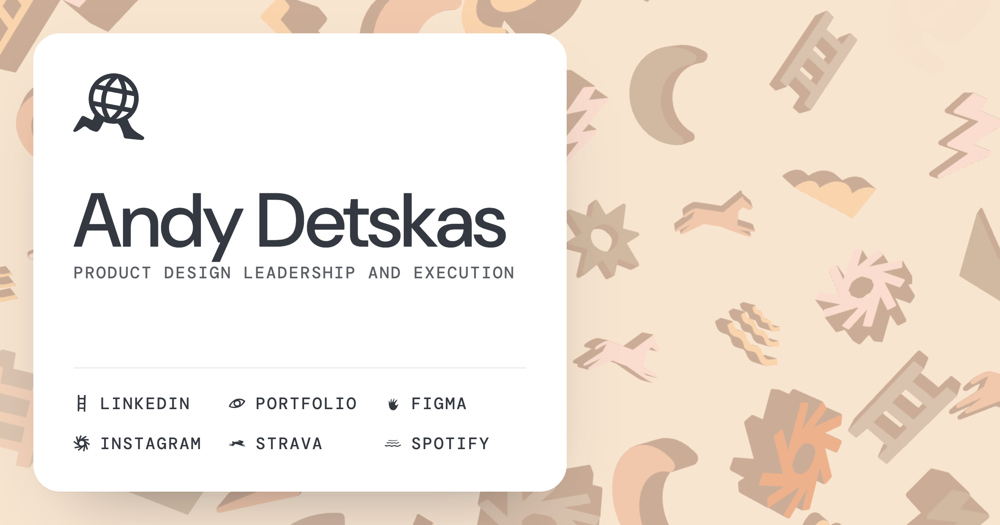

# bento

The code behind my portfolio, [andydetskas.com](https://www.andydetskas.com), and my link card, [links.andydetskas.com](https://links.andydetskas.com). Both sit over the same generative 3D background.



I'm Andy Detskas, a product design leader. I designed and built this hands-on with Claude Code: I made the decisions and reviewed and approved the copy; the agent wrote code, drafted copy and checked my work. It's also the first build of **Taos**, my personal design system.

## What's in here

- **Glyphs, the 3D background** (`src/lib/shape-field/`). Taos icons, which began as doodles, extruded into 3D with Three.js and no framework. `prepareShapeField(preset)` builds the meshes one task at a time, then `createShapeField(canvas, preset)` returns a small controller: `seek`, `setPreset`, `setPalette`, `setParam`, `setPaused`, `snapshot` and `destroy`. There are four scene families: `glyphs`, `pueblo`, `ridgeline` and `petal`.
- **The lab** ([live](https://links.andydetskas.com/lab), `src/pages/lab.astro`). A tuning panel for the scene, palette, glyphs, motion and card. "Copy preset" gives you a block to paste into `src/lib/presets.ts`. The [Glyph lab](https://www.andydetskas.com/techniques/glyph-lab/) article tells how it came together.
- **Tokens first** (`tokens/taos.tokens.json`). One file in the W3C design-tokens format, built into CSS custom properties and a TypeScript module by `npm run tokens`. Components read role tokens, never raw palette values. Type sits on a 4px baseline with fluid steps (the Utopia method), and line heights snap to it with CSS `round()`.
- **Display settings** (`src/components/site/DisplaySettings.astro`). Theme, text size, a readable typeface, WCAG 1.4.12 text spacing, high contrast, highlighted links and focus, and motion, saved per visitor and applied before first paint. It avoids the overlay-widget mistakes on purpose. The [Display settings](https://www.andydetskas.com/techniques/display-settings/) article explains the choices.
- **Moving between pages.** Cross-document view transitions, and the scene keeps its clock from page to page, so the background carries on instead of restarting. That includes the hop from the link card to the site, which is a different origin.
- **Readable by answer engines.** Every page carries one JSON-LD block, and the build writes `llms.txt`, a sitemap and a Markdown copy of each article.

## Performance on phones

The scene loads after first paint, builds its meshes one task at a time and compiles its shaders asynchronously, so taps stay responsive while it loads. Measured with `npm run perf` (emulated phones on slow 4G):

| | Mid-range phone (CPU 4x slower) | Low-end phone (CPU 6x slower) |
|---|---|---|
| Longest main-thread task during start-up | about 55–70 ms | about 75–90 ms |

While it runs: under 1 ms of JavaScript per frame, a steady 60 fps, and about 16 draw calls per frame on a phone.

## Run it

Needs Node 22 (see `.nvmrc`).

```bash
npm install
npm run dev
```

- http://localhost:4321/ is the link card, `/lab` the lab and `/site/` the portfolio.
- `npm run build` builds the link card for GitHub Pages. `npm run build:www` builds the portfolio for [www.andydetskas.com](https://www.andydetskas.com).
- `npm run perf` runs the phone check above. Run `npm run build && npm run preview` first.

How each part works, and why, is in [docs/build-notes.md](docs/build-notes.md).

## License

The **code** is MIT licensed (see [LICENSE](LICENSE)): the components, pages, scripts, the `shape-field` engine and the token build. Fork the engine and give it your own icons.

The **content** isn't covered by that license. All rights reserved:

- My writing: the case studies, articles and other copy in `src/content/` and in the case-study pages under `src/pages/site/work/`.
- The Taos icons and marks in `src/icons/`.
- The images, video and documents in `public/`, including my photos and résumé.
- The work from Strava, SRAM and SuppCo shown in the case studies, and every company name and logo. These belong to their owners and appear here as portfolio work.

The fonts, DM Sans, DM Mono and Atkinson Hyperlegible, are under the SIL Open Font License and are installed from npm through Fontsource.
